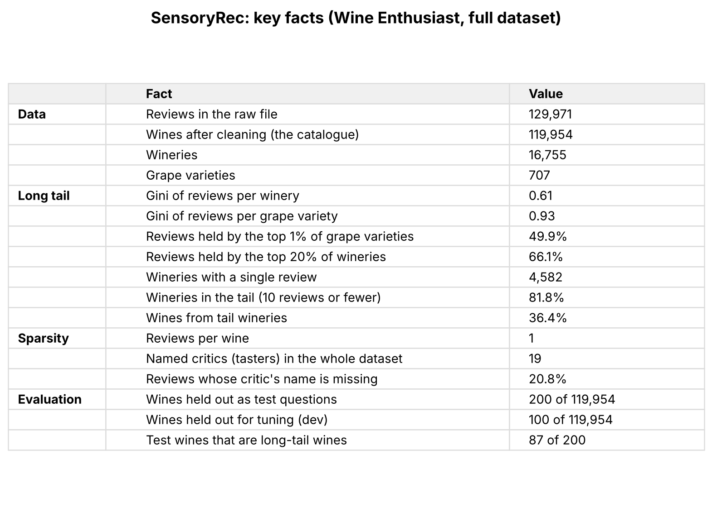
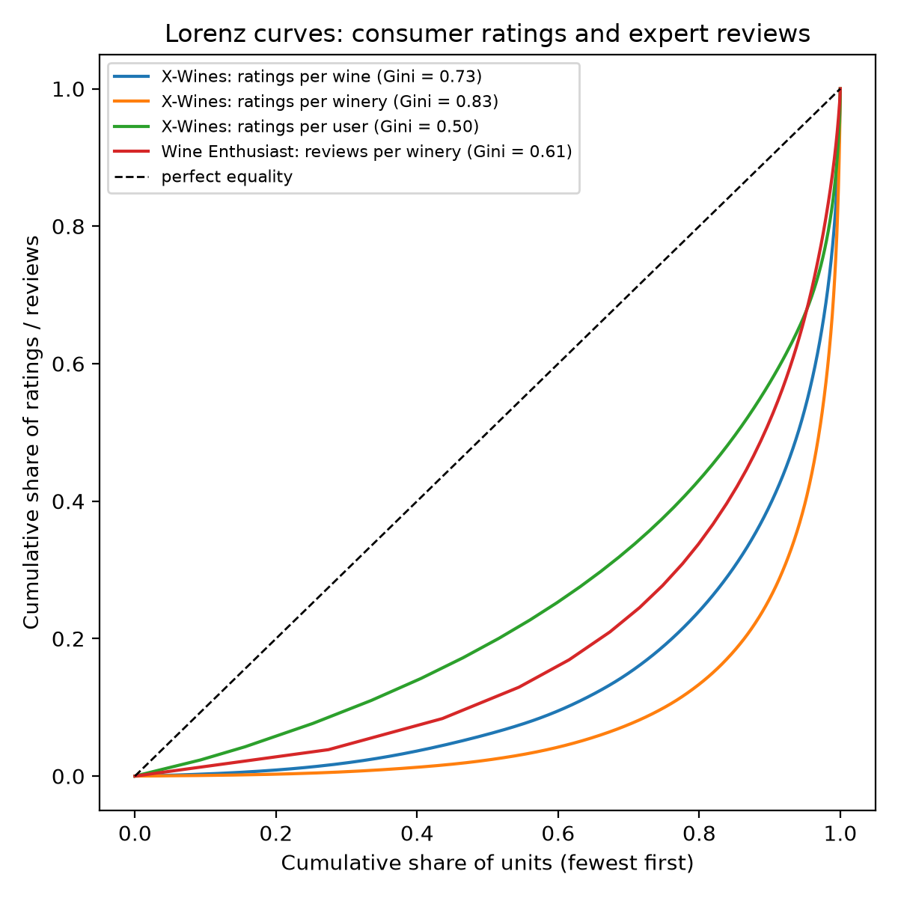
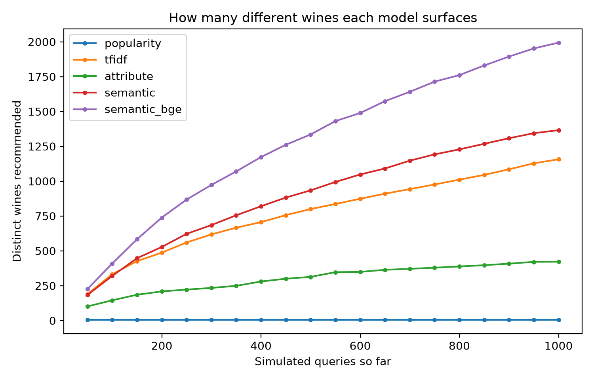
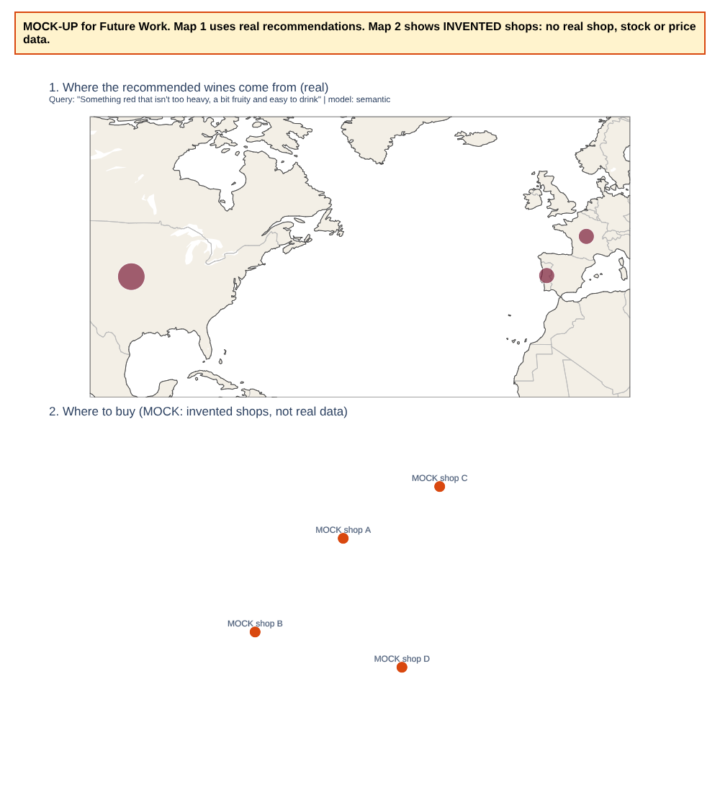
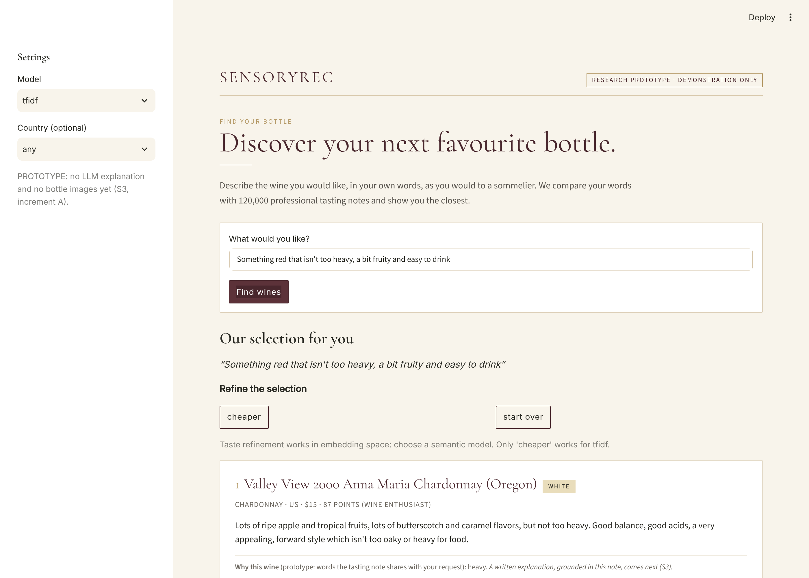
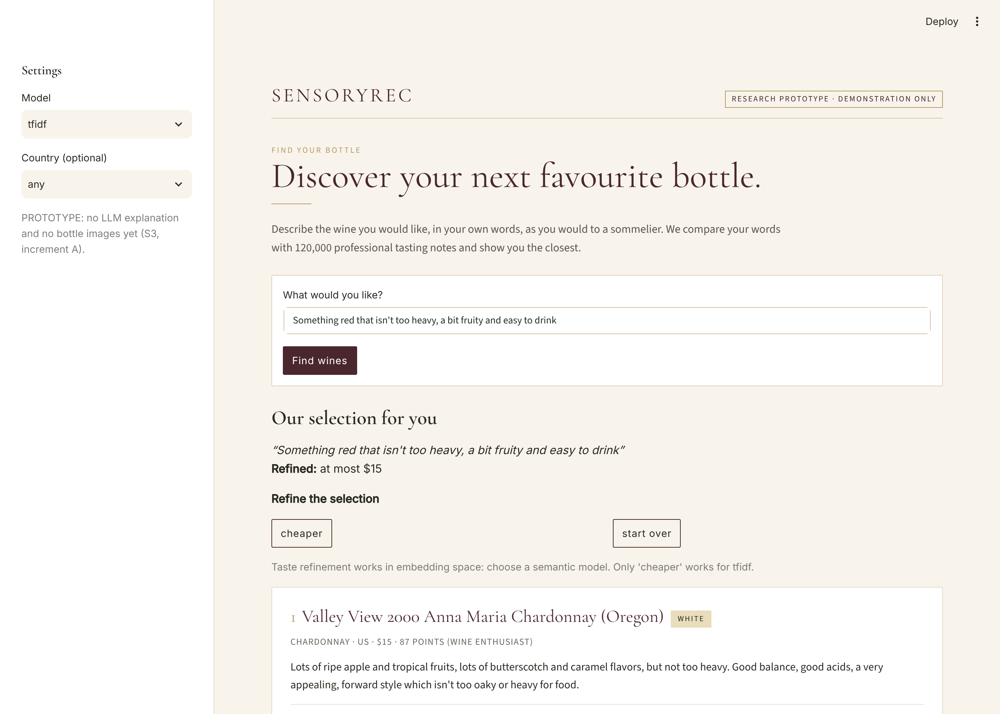

# SensoryRec: progress since the meeting of 2 Nov 2026

**Paul Coyral, IE University BDBA Capstone · supervisor meeting 16 Nov 2026**

At the last meeting you asked for five things. Each one is done and has a
results file behind it. Every number below is copied from the file named next
to it, and every file is regenerated by one command.

| You asked for | Status | Where |
|---|---|---|
| 1. Double-check the Roger Voss count | Done: the count is real | `results/eda/taster_by_country.csv` |
| 2. More user data (Vivino) | Done with an open dataset instead of scraping: X-Wines, 21 million consumer ratings | `results/xwines/` |
| 3. ~1,000 LLM-simulated queries, coverage and diversity across models | Done: 1,000 queries, 5 models | `results/simulated_coverage.csv` |
| 4. Try Gemini / other embeddings | A second open embedding model is in every comparison; Gemini writes the simulated queries | `config.yaml`, all result tables |
| 5. Python map libraries | Comparison note and one labelled mock-up | `docs/map_libraries.md`, `docs/map_mockup.html` |
| (new) First chat prototype | Request → top 5 → one-click refinement | `make app` |

New since then: the **accuracy test** on the 200 held-out wines has results
(section 6, with an unexpected finding), and a **first prototype** of the
app (section 7).

---

## 1. Roger Voss: the count is real

- He wrote **23,558** of the 119,954 cleaned reviews (**19.6%**), the most of
  any of the 19 critics (`results/eda/summary.csv`).
- The reason is regional: Wine Enthusiast gives each region to one critic.
  He covers **84.3%** of French and **99.4%** of Portuguese reviews; Michael
  Schachner covers almost all of Spain, Chile and Argentina
  (`results/eda/taster_by_country.csv`).
- **"No taster" reviews** (20.8%) are real reviews without a critic's name.
  They are concentrated in the US (31.7% of US reviews) and Italy (44.5%), and
  in older vintages (`results/eda/missing_taster_by_vintage.csv`).
- **Limitation for the thesis:** with one critic per region, a text model can
  partly learn a critic's writing style instead of the wine. Stated as a
  threat to validity.

## 2. More user data: X-Wines instead of Vivino

Vivino's terms of service forbid scraping, so I used **X-Wines** (de Azambuja,
Morais & Filipe 2023, *Big Data and Cognitive Computing* 7(1):20), a published
dataset of consumer ratings collected on the open web, licence **CC0**. It is
used **for analysis only**: it shows the long tail and sparsity of real
consumer behaviour, which motivates the content-based approach. No model is
trained on it, and it is not matched to the Wine Enthusiast wines.

From `results/xwines/summary.csv` and `long_tail.csv` (Full version):

| | X-Wines (consumers) | Wine Enthusiast (experts) |
|---|---|---|
| Wines | 100,646 | 119,954 |
| Ratings / reviews | 21,013,536 | 119,954 (one per wine) |
| Users | 1,056,079 | 19 critics |
| Density of the user × wine matrix | 0.0194% | n/a |
| Gini, per winery | **0.83** | 0.61 |
| Share held by the top 20% of wineries | **86.6%** | 66.1% |
| Median ratings per user | 11 | |

What it shows:

- **Consumer attention is even more concentrated than the critics'.** The top
  20% of wineries receive 86.6% of all consumer ratings.
- **Extreme sparsity:** each user has rated about 0.02% of the wines. Even with
  a million users, most user-wine pairs are empty: the cold-start problem the
  thesis is about.
- **Caveat:** every wine in X-Wines has several ratings (none has only one,
  `pct_units_with_1` in `long_tail.csv`): wines nobody rated are not in the
  dataset, so the real tail is longer than X-Wines shows.

## 3. 1,000 simulated queries: coverage and diversity

**How the queries were made.** An LLM asked for "1,000 different requests"
repeats itself. So the variety is built first: 1,000 different "briefs" are
drawn with a fixed seed from lists of everyday wishes (kind of wine,
sweetness, flavours, occasion, budget, country). Gemini
(`gemini-3.5-flash-lite`, free tier, temperature 0) only turns each brief into
a customer's sentence, for example:

> "Can I get a light, sweet rosé with a lemon taste for our Christmas dinner?"
> "I need a light wine as a gift for my boss that tastes like vanilla and chocolate."

Every query is checked against the 85 banned expert words: all 1,000 passed,
35 after one retry (`results/simulated_queries_quality.csv`). Every Gemini
answer is cached and committed, so the study reruns without any API call.

**Results** (top 5 for each query = 5,000 recommendations per model;
`results/simulated_coverage.csv`):

| Model | Different wines | Wineries reached | Grape varieties reached | Share from long-tail wineries |
|---|---|---|---|---|
| Popularity | 5 | 0.01% | 0.6% | 0% |
| Attribute | 422 | 1.9% | 8.9% | 32.2% |
| TF-IDF | 1,157 | 5.7% | 18.5% | 47.8% |
| Semantic (Sentence-BERT) | 1,366 | 6.8% | 23.6% | 39.4% |
| Semantic (bge-small) | **1,994** | **9.2%** | **28.2%** | 40.3% |

- **Popularity** gives the same five wines to everyone: the cold-start problem
  in one line.
- **The embedding models reach the most of the catalogue**, and their curves
  are still rising at 1,000 queries: more people would still discover new
  wines.
- **All text models put a large share on long-tail wineries** (the tail is
  36.4% of the catalogue, `results/eda/tail_summary.csv`).
- **How to read coverage:** 5,000 recommendations cannot cover 120,000 wines;
  the ceiling is about 4%. Models are compared with each other.
- **This study measures breadth, not accuracy.** It is read together with the
  self-retrieval test (section 6).

## 4. Embeddings beyond Sentence-BERT

- **Added:** `BAAI/bge-small-en-v1.5`, an open model that runs on GitHub's
  machines without a key. Same recommender code; it appears in every table,
  the demo and the evaluation. Both models' exact versions are pinned.
- **Gemini** (`gemini-3.5-flash-lite`) writes the simulated queries. The
  course notebook's model, `gemini-2.5-flash`, is no longer available to new
  users, and the free tier allows 20 requests a day for Flash models against
  500 for Flash Lite (documented in `DECISIONS.md`).
- **Gemini embeddings** (`gemini-embedding-001`) for the 120,000 notes are the
  next candidate; whether the free quota allows it (batch requests of many
  notes) is the open question.

## 5. Map libraries

`docs/map_libraries.md` compares **folium, plotly and pydeck**. Our data has
country, province and region names but no coordinates. Plotly can place a
country from its ISO code, so the "where do my wines come from" map works
without geocoding, and it plugs directly into Streamlit or Gradio.

The mock-up (`make map-mockup`, `docs/map_mockup.html`) has two maps:
1. **Real:** the countries of origin of the top 5 for one query.
2. **MOCK:** "where to buy", with invented shops, labelled on every pin. Maps
   stay Future Work.

## 6. Self-retrieval evaluation (accuracy)

**The test.** Each of the 200 held-out wines (never used for fitting) was
rewritten by a local LLM (Llama 3.2 3B, temperature 0) as what a novice would
say about it, without expert words, names, places or prices. Each model gets
the request and must put **that exact wine** in its top 5 out of ~120,000.

**The queries** (`results/queries_quality.csv`): 200 test queries, none
flagged; 17.5% needed one rewrite after the expert-word check. Example:

> Note: "…so rich and smooth in berry, cherry, currant and spice flavors…"
> Query: "It tastes really rich and smooth, with lots of berry and spice
> flavors that feel nice and velvety in my mouth."

**Results** (`results/ablation.csv`, 200 test queries):

| Model | HR@5 (exact wine in top 5) | NDCG@5 | Long-tail share | Diversity (ILD) |
|---|---|---|---|---|
| Popularity | 0% | 0.000 | 0% | 0.46 |
| Attribute | 0% | 0.000 | 47.5% | 0.47 |
| **TF-IDF** | **9.5%** (19 of 200) | **0.080** | 41.4% | 0.41 |
| Semantic (Sentence-BERT) | 0.5% (1 of 200) | 0.005 | 44.1% | 0.22 |
| Semantic (bge-small) | 3.0% (6 of 200) | 0.023 | 40.2% | 0.27 |

**This is not the expected result, and I report it as it is:** on the
exact-wine test, keyword matching (TF-IDF) beats both semantic models. What
explains it:

1. **The queries copy the critic's words.** On average a quarter of a
   query's content words also appear in its tasting note (`copy_share_mean`
   in the quality file). Distinctive copied words ("dusty", "raspberry",
   "apple cider") point TF-IDF straight at the right note.
2. **One correct wine out of 120,000 is a very strict target.** A request
   like "sweet, fruity, smooth red" describes thousands of wines. The
   semantic models return wines of the right kind (all reds for a red
   request in the demo; TF-IDF's first pick for that request is a
   Chardonnay) but rarely *the* wine the query came from.
3. **The numbers are small**: 1 vs 6 vs 19 hits. On the 100 dev queries the
   gap is smaller (`results/ablation_dev.csv`).

What it means for the thesis: the exact-wine test alone cannot say whether a
recommendation is *good*. Three ways to complete it, for the supervisor to
weigh in on:

- **Graded relevance:** the sommelier rates the top 5 of each model for a
  sample of queries (already planned).
- **Human queries:** the ~30 novice-written queries should copy the notes
  less, which removes TF-IDF's advantage if (1) is the cause.
- **Closeness, not only hits:** report where the target lands (its rank, or
  hits in the top 50/100). This would be a new metric, decided before
  looking at those numbers.

**Refinement works** (`results/refinement.csv`). Success = the share of top-5
notes with a *separate* trait word moves the right way, against random
directions of the same size:

| Refinement | Success | Random direction |
|---|---|---|
| sweeter | 88.0% | 6.3% |
| more oaky | 95.5% | 11.2% |
| heavier | 54.0% | 4.3% |
| more acidic | 69.5% | 25.8% |
| more fruity | 37.9% | 13.6% |
| cheaper | median price −20%, relevance cost 0.008 | |

Caveat: the step size chosen on dev (0.5) is the largest in the grid, so a
larger one might work better (`results/refinement_alpha_dev.csv`).

## 7. First prototype of the chat app (S3)

`make app` opens a page in the browser: describe a wine in your own words,
get the top 5 from the Sentence-BERT engine with their tasting notes, then refine with one
click (**sweeter / drier, heavier / lighter, more / less fruity, oaky,
acidic**, or **cheaper**). The taste buttons move the query in embedding space
with the direction vectors and step size of the refinement study; "cheaper"
caps the price at the median of the wines on screen.

Still to come in S3: the **LLM explanation**, written only from the retrieved
notes (the box under each wine shows, for now, the words the note shares with
the request), the complete worked example, and later the bottle images.

*This screenshot was taken with the TF-IDF model, because Sentence-BERT cannot
download on the machine that built these documents; the app itself now uses
Sentence-BERT only, with Gemini embeddings to be added as the alternative.
TF-IDF's first pick is a Chardonnay for a red request: it matched "not too
heavy", not the meaning.*

An interactive version with the real Sentence-BERT results for the five demo
requests: https://claude.ai/artifact/NnjKSqwn38iCqk68oVpD3x

## 8. Corrections to the last meeting

Four points from the last meeting, stated precisely:

1. Each wine has **exactly one** review, written by one of **19** critics.
2. 707 is the number of **grape varieties**; 200 test and 100 dev wines were
   held out of the **119,954** wines.
3. The top 20% of wineries hold **66.1%** of the reviews, not about 30%
   (`results/eda/top_share.csv`).
4. The log-log rank-frequency plot is meaningful: a straight-ish line on
   log-log axes is the signature of a long tail.

## 9. Next steps (proposal)

1. **S3:** the chat app (query → top 5 → refinement → grounded explanation),
   one complete worked example.
2. Human-written queries (about 30) once IE's ethics guidance is clear, to
   check how realistic the LLM queries are.
3. Gemini embeddings if the free quota allows.
4. Literature review: long tail and popularity bias, RAG faithfulness.
